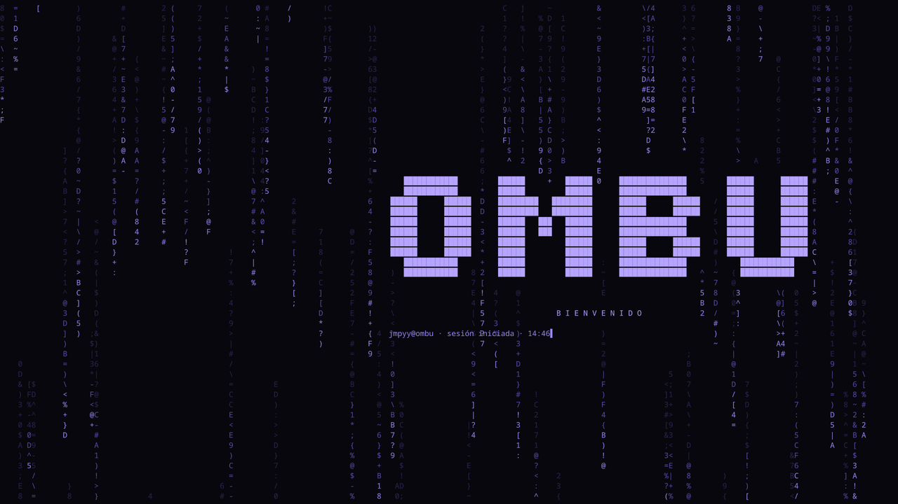
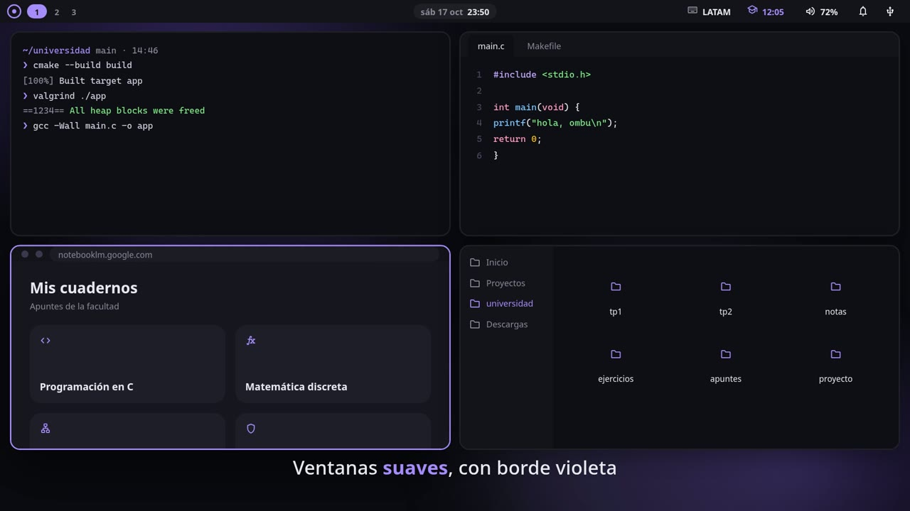
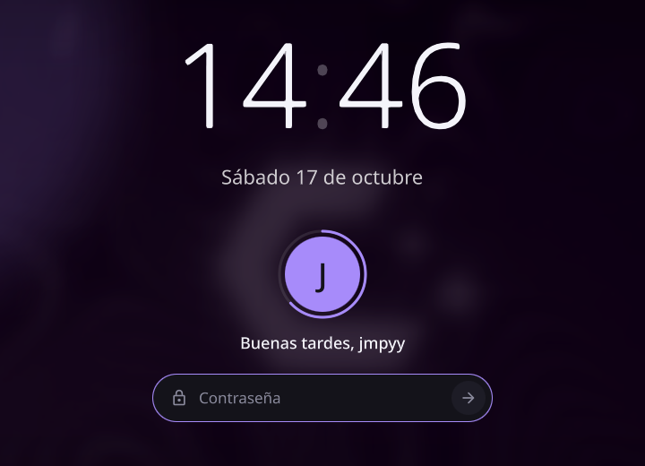
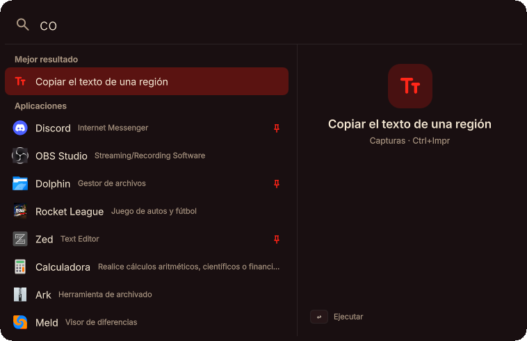
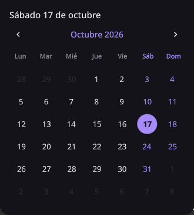
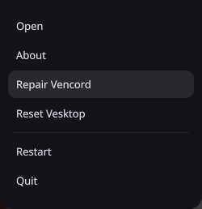
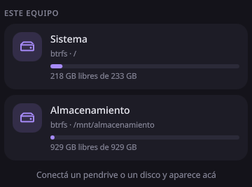
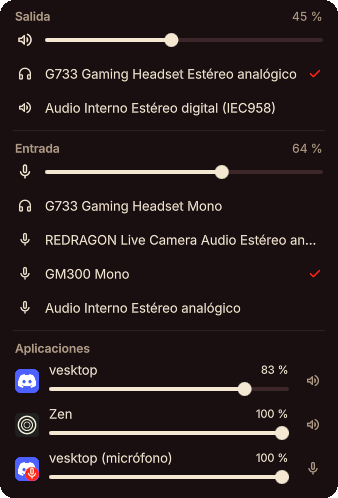
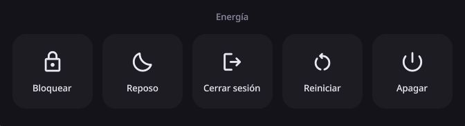

# ombu

Un escritorio propio para **Hyprland**, hecho con [Quickshell](https://quickshell.org) (QML): barra superior, menús, notificaciones, launcher, bloqueo de pantalla, pantalla de inicio de sesión y una bienvenida. Todo en un solo repositorio, con un mismo diseño.

La idea: la integración con el borde del monitor que da Caelestia Shell (las barras y los menús *nacen* de la pantalla), el estilo de macOS, los atajos de Omarchy y la barra de tareas de Windows para saber siempre qué tenés abierto. Menús **sólidos** (sin transparencias) y minimalismo.

> *English, in one line:* a self-contained Hyprland desktop shell written in Quickshell/QML (bar, menus, notifications, launcher, lock screen, greetd greeter). The UI is in Spanish; see [Personalizar](#personalizar) to change it.

<p align="center">
  
</p>

<p align="center">
  <a href="docs/ombu-teaser.mp4">
    
  </a>
  <br>
  <sub>▶ Teaser de 38 s: barra, menús, launcher, modo foco y ventanas. Es una animación hecha aparte con HTML, <a href="https://motion.dev">Motion</a> y ffmpeg, no una grabación del escritorio.</sub>
</p>

## Qué incluye

**Barra superior** integrada al borde del monitor, con esquinas cóncavas. Los menús crecen desde el botón que los abre.

| | |
|---|---|
| **Escritorios** | Los escritorios de cada monitor (cada barra muestra los suyos), con el ícono de la app de cada uno; el activo se ensancha con su número. El escritorio `gaming` de Hyprland aparece cuando tiene ventanas. |
| **Reloj y calendario** | Fecha y hora; al pasar el mouse la fecha se completa. Clic abre el calendario. |
| **Volumen y mezcladora** | Dispositivo de salida y de entrada, y un volumen por cada app. Rueda cambia el volumen, clic del medio silencia. |
| **Notificaciones** | Servidor propio (reemplaza a swaync, mako o dunst): tarjetas animadas, historial, *No molestar*, acciones. |
| **Dispositivos** | Discos y unidades conectadas con el espacio libre; monta y expulsa pendrives. |
| **Bandeja del sistema** | Los íconos de las apps (Discord, Steam...) con un menú propio al hacer clic derecho. |
| **Apps abiertas** | Ventanas, las minimizadas y las que siguen corriendo sin ventana. |

**Y además:**

- **Launcher** estilo Spotlight (`Super+Espacio`): una barra de búsqueda y, vacía, tus apps de siempre (favoritas y las que más abrís, aprende solo). Oculta los ajustes y herramientas del sistema de la lista principal, aunque los encontrás al escribir su nombre. `Enter` abre la app o, si ya está abierta, **enfoca su ventana** (no abre otra); `Shift+Enter` fuerza una ventana nueva. `Ctrl+P` fija o suelta una favorita.
- **Menú de energía** al centro: Bloquear, Reposo, Cerrar sesión, Reiniciar y Apagar (las dos últimas piden un segundo toque).
- **Indicador de volumen** (OSD) discreto.
- **Bloqueo de pantalla** real (`ext-session-lock`): reloj, avatar, contraseña con PAM, música en reproducción, notificaciones y aviso de Bloq Mayús.
- **Salvapantallas ASCII**: tras 5 minutos sin actividad se bloquea la sesión con una lluvia de código que descifra el logo; a los 30 se apagan los monitores.
- **Pantalla de inicio de sesión** para [greetd](https://sr.ht/~kennylevinsen/greetd/), con el mismo diseño que el bloqueo.
- **Bienvenida** al iniciar sesión: lluvia de código, el logo que se descifra y la barra que baja desde el borde.
- **Capturas** con editor para anotar y recortar, miniatura en el aviso (clic para editarla, botón para borrarla) y OCR para copiar texto de la pantalla.
- Avisos cuando Claude Code o Antigravity terminan una tarea larga (y no los muestra si ya tenés la terminal a la vista).
- **Centro de control** en la barra (ícono de ajustes): slider de **brillo** del monitor (por DDC/CI con `ddcutil`, sirve para monitores externos de escritorio), slider de volumen, layout de teclado, modo foco, No molestar y dispositivos. Así la barra queda con lo esencial. Si hay unidades conectadas, el botón muestra cuántas.
- **Proyectos de C para estudiar:** `bin/cproj.sh nombre` crea en `~/universidad` un proyecto con CMake (avisos estrictos), `compile_commands.json` para clangd y un Makefile con `make run`, `make leaks` (valgrind), `make asan` y `make debug` (gdb).
- **Modo foco** en la barra: temporizador de estudio y descanso (25/5), tres modos (estudio, trabajo, libre), estadística y racha del día, un entorno de estudio que se abre al empezar (NotebookLM, el editor y una terminal con la IA, según estudies programación, matemática u otra cosa), un cajón para anotar ideas sin distraerte y, en modo estudio, un bloqueo de juegos y de redes sociales (Instagram, TikTok...; YouTube no) que avisa antes de cerrarlos y se puede saltar esperando 60 segundos.
- **Historial del portapapeles** con búsqueda, miniaturas de imágenes, textos fijados y pegado automático en la ventana donde estabas. No guarda lo que las apps marcan como sensible (gestores de contraseñas), se puede pausar y se vacía en cada sesión nueva.
- Un explorador de archivos que se abre donde está tu terminal.

<p align="center">
  
  
</p>
<p align="center">
  
  
</p>
<p align="center">
  
  
</p>
<p align="center">
  
</p>

## Requisitos

Hecho y probado en **CachyOS** con **Hyprland 0.56** (configuración en Lua) y **Quickshell 0.3.2**. Debería andar en cualquier Arch con lo mismo.

```sh
sudo pacman -S quickshell hyprland ttf-material-symbols-variable \
    pipewire wireplumber playerctl brightnessctl \
    cliphist wl-clipboard grim slurp libnotify satty \
    tesseract tesseract-data-spa tesseract-data-eng \
    udisks2 papirus-icon-theme python
```

- `ttf-material-symbols-variable`: la fuente de los íconos (Material Symbols Rounded).
- `papirus-icon-theme`: ombu usa sus íconos para Discord y Minecraft (ver `Icons.qml`).
- `cliphist` y `wl-clipboard`: historial del portapapeles (`Super+V`). `grim` y `slurp`: capturas.
- `satty`: el editor de capturas (anotar y recortar). `tesseract` y sus datos de idioma: copiar texto de una imagen. Sin ellos las capturas siguen funcionando, solo que sin editor ni OCR.
- `udisks2`: montar y expulsar unidades desde el menú de dispositivos.
- Opcional: `greetd` para la pantalla de inicio de sesión.

> ombu **es** el servidor de notificaciones. Detené cualquier otro (`swaync`, `mako`, `dunst`, el de Caelestia...) o los dos pelearán por `org.freedesktop.Notifications`.

## Instalación

La carpeta **tiene que llamarse `ombu`** y estar en `~/.config/quickshell/` (los atajos usan `quickshell -c ombu`).

```sh
git clone https://github.com/Jmpyy/OMBU ~/.config/quickshell/ombu
```

Después sumá una línea a tu `~/.config/hypr/hyprland.lua`:

```lua
dofile(os.getenv("HOME") .. "/.config/quickshell/ombu/hypr/ombu.lua")
```

Ese archivo ([`hypr/ombu.lua`](hypr/ombu.lua)) arranca el shell, agrega los atajos y las reglas que hacen falta. Léelo antes: si ya usás alguno de esos atajos, cambialo ahí. Recargá Hyprland y listo. Para probarlo sin tocar tu configuración: `quickshell -c ombu`.

### Atajos

| Atajo | Qué hace |
|---|---|
| `Super + Espacio` | Launcher de aplicaciones |
| `Super + Esc` / `Super + X` | Menú de energía |
| `Super + Ctrl + L` | Bloquear la sesión |
| `Super + B` | Mostrar u ocultar la barra |
| `Super + V` | Historial del portapapeles (`Enter` pega, `Shift+Enter` copia, `Ctrl+P` fija) |
| `Print` | Captura de una región con editor (anotar y recortar); `Enter` copia y guarda |
| `Shift + Print` | Captura de una región, directo |
| `Super + Print` | Captura del monitor con foco |
| `Ctrl + Print` | Copiar el texto de una región de la pantalla (OCR) |
| `Super + Shift + E` | Explorador de archivos en la carpeta de la terminal |
| `Super + ,` | Cerrar la última notificación |
| `Super + Shift + ,` | Cerrar todas |
| `Super + Ctrl + ,` | No molestar (activar o desactivar) |
| `Super + Alt + ,` | Ejecutar la acción de la última notificación |
| `Super + Shift + Alt + ,` | Historial de notificaciones |
| `Super + N` / `Super + Shift + N` | Minimizar la ventana / ver las minimizadas |
| `Super + O` | Ventana flotante fija (Picture-in-Picture) |
| `Super + R` | Modo redimensionar con las flechas (`Esc` sale) |

### Control desde la terminal (IPC)

```sh
qs -c ombu ipc call bar toggle        # mostrar u ocultar la barra
qs -c ombu ipc call bar mixer         # también: calendar, apps, devices, tray
qs -c ombu ipc call launcher toggle   # o: search "texto", close, run ID (abre o enfoca una app)
qs -c ombu ipc call clip toggle       # historial del portapapeles
qs -c ombu ipc call notif dnd         # también: dismiss, dismissAll, invoke, history
qs -c ombu ipc call lock lock         # bloqueo real
qs -c ombu ipc call lock preview      # vista previa (ventana común, Esc la cierra)
qs -c ombu ipc call lock saver        # vista previa con el salvapantallas
qs -c ombu ipc call idle test 10      # simula la inactividad con 10 s (idle reset vuelve)
qs -c ombu ipc call welcome play      # repite la bienvenida
qs -c ombu ipc call power toggle      # menú de energía
qs -c ombu ipc call bar focus         # menú del modo foco
qs -c ombu ipc call focus start       # también: pause, stop, skip, mode estudio|trabajo|libre
qs -c ombu ipc call focus idea "texto"   # anota una idea en el cajón
qs -c ombu ipc call focus status      # estado del temporizador y del bloqueo
qs -c ombu ipc call focus kit matematica # tipo de estudio; open abre el entorno completo
```

## Pantalla de inicio de sesión (greetd)

Reemplaza al greeter que uses hoy. Es opcional y cambia archivos del sistema, así que leé antes qué hace:

```sh
sudo bash ~/.config/quickshell/ombu/greeter/install.sh
```

- Copia el greeter a `/usr/share/ombu-greeter` y un script de sesión a `/usr/local/bin`.
- Genera una configuración mínima de Hyprland para el greeter con **tu** teclado y monitor principal, y la **valida antes de tocar nada**.
- Guarda `/etc/greetd/config.toml.noctalia-backup` y cambia solo el comando del greeter.
- **No reinicia greetd**: tu sesión actual sigue intacta; el cambio se ve en el próximo inicio de sesión.
- **Respaldo:** si el greeter de ombu no arranca bien, cae solo a otro (por defecto `noctalia-greeter-session`; se cambia con `OMBU_GREETER_FALLBACK`). Si no tenés ninguno, el instalador se detiene y te avisa.
- Para deshacerlo: `sudo bash ~/.config/quickshell/ombu/greeter/uninstall.sh`. Si no ves la pantalla de ingreso, `Ctrl+Alt+F2` te da una consola.

Cada vez que cambies algo del diseño que usa el greeter (colores, bloqueo), volvé a correr el instalador para actualizar la copia del sistema.

## Personalizar

Todo el aspecto sale de [`Theme.qml`](Theme.qml): colores, radios, tamaños de la barra, tiempos de inactividad y del salvapantallas.

- **Fondo de pantalla:** `Theme.wallpaper` apunta a un fondo de CachyOS; cambialo por el tuyo.
- **Inactividad:** `idleLockSeconds` (bloqueo, 5 min) e `idleScreenOffSeconds` (monitores, 30 min).
- **Idioma:** los textos están en español y la fecha usa `es_AR` (`Chrono.qml`).
- **Launcher:** las favoritas de fábrica y lo que se oculta están en [`Launch.qml`](Launch.qml); lo que abrís y fijás se guarda en `~/.local/share/ombu/launcher.json`.
- **Íconos de apps:** si una app trae un ícono que no te gusta, agregala a [`Icons.qml`](Icons.qml).
- **Escritorios:** cada barra muestra los escritorios que Hyprland asigna a su monitor (reglas `hl.workspace_rule`, ver `hypr/ombu.lua` y tu `workspaces.lua`).
- **Modo foco:** [`Focus.qml`](Focus.qml) tiene las duraciones (25/5/15), los juegos que se bloquean (`blockedPattern`, `blockedProcesses`), los sitios (`blockedSites`: se cierra la pestaña activa del navegador; YouTube queda libre) y qué se abre en cada tipo de estudio (`kits`, con la carpeta de la facultad en `studyDir`). Lo que anotás en el cajón queda en `~/.local/share/ombu/ideas.md`.
- **Modo estudio para la IA:** [`bin/agent-study.sh`](bin/agent-study.sh) le pasa a Claude Code y a Antigravity unas reglas mientras dura un bloque de estudio (enseñar en vez de resolver, ideas ajenas al cajón). Se conecta con un hook de cada herramienta, ver [`AGENTS.md`](AGENTS.md).
- **Notificaciones:** [`NotifRules.qml`](NotifRules.qml) permite pasar a español los avisos de ciertas apps y descartar los de algo que ya tenés a la vista (viene una regla para Claude Code en kitty).

Quickshell recarga solo al guardar un archivo `.qml`.

## Extras (opcionales)

Nada de esto hace falta para usar ombu; sirve para que el explorador de archivos (Dolphin) y otras apps de Qt combinen con el resto.

- [`extras/qt6ct/`](extras/qt6ct): paleta y estilo de ombu para `qt6ct` (botones y pestañas redondeados, barras finas). Copiá `ombu.qss` a `~/.config/qt6ct/qss/` y `colors/ombu.conf` a `~/.config/qt6ct/colors/`, y en `qt6ct.conf` poné `color_scheme_path=` con esa ruta y `stylesheets=` con la del `.qss`. Después lanzá la app con `QT_QPA_PLATFORMTHEME=qt6ct` (conviene hacerlo solo para las apps que quieras, no para todo el sistema).
- [`extras/kitty/`](extras/kitty) y [`extras/starship.toml`](extras/starship.toml): la terminal [kitty](https://sw.kovidgoyal.net/kitty/) con los colores de ombu (fondo sólido, fuente Nerd Font, pestañas y divisiones) y un prompt minimalista con [starship](https://starship.rs). Copiá `kitty.conf` y `themes/` a `~/.config/kitty/` y `starship.toml` a `~/.config/`; en fish agregá `starship init fish | source`. Necesita la fuente *CaskaydiaCove Nerd Font* (`ttf-cascadia-code-nerd`).
- [`extras/fastfetch/`](extras/fastfetch) y [`extras/fish/ombu.fish`](extras/fish/ombu.fish): el saludo de la terminal con el logo OMBU hecho de texto (no se pierde al cambiar de escritorio, como las imágenes) y solo seis datos, más búsqueda con `fzf` (`Ctrl+R`, `Ctrl+T`, `Alt+C`), `zoxide` y los colores de ombu para el resaltado de fish, la sugerencia en gris y la lista de Tab. Copiá la carpeta a `~/.config/fastfetch/` y el contenido de `ombu.fish` a tu `config.fish`.
- [`extras/zed/`](extras/zed): el tema **Ombu** para el editor [Zed](https://zed.dev) (fondo, superficies, acento violeta, colores de sintaxis y los 16 de la terminal iguales a los de kitty) y una `settings.json` con la fuente Nerd Font, sin ligaduras y con `clangd` para C. Copiá `ombu.json` a `~/.config/zed/themes/` y `settings.json` a `~/.config/zed/`. En Arch el comando es `zeditor`. La ventana opaca está en `hypr/ombu.lua`.
- [`extras/atuin/`](extras/atuin): [atuin](https://atuin.sh) como historial de comandos: `Ctrl+R` abre una lista debajo del prompt con búsqueda difusa, carpeta, duración y si salió bien, con los colores de ombu. Todo queda en tu PC (sin sincronización) y filtra comandos que parezcan contener claves. Copiá `config.toml` y `themes/` a `~/.config/atuin/` y agregá `atuin init fish --disable-up-arrow | source` a tu `config.fish` (está en `extras/fish/ombu.fish`).
- [`extras/satty/config.toml`](extras/satty/config.toml): configuración del editor de capturas (herramienta inicial, paleta de ombu, Enter copia y guarda). La ventana flotante y opaca está en `hypr/ombu.lua`.
- [`extras/icons/make-ombu-icons.py`](extras/icons/make-ombu-icons.py): crea el tema de iconos *Ombu*, que es Papirus-Dark con las carpetas en violeta.

## Cosas a tener en cuenta

- **Un solo usuario.** El greeter y el bloqueo están pensados para una PC personal.
- **NVIDIA y suspender:** en la RTX 2060 de quien lo escribió el suspend real cuelga la GPU al despertar, así que ombu no tiene "Suspender": tiene **Reposo**, que bloquea y deja el salvapantallas a la vista. Si tu equipo suspende bien, podés cambiar esa acción en `PowerMenu.qml`.
- **Contraseña:** el bloqueo usa PAM con la configuración de [`pam.d/unlock`](pam.d/unlock) (solo `pam_unix`, sin `faillock`), así no se bloquea la cuenta por errores de tipeo. Si preferís `faillock`, agregalo ahí.
- **Si el bloqueo se cuelga:** la regla `allow_session_lock_restore` permite lanzar otro desde una TTY con `quickshell -c ombu -d`.

## Estructura

```
shell.qml          punto de entrada: ventanas por monitor y comandos IPC
Theme.qml          colores, tamaños y tiempos
TopBar.qml         la barra (y WorkspaceStrip, TrayStrip, BarButton...)
*Menu.qml          los menús que cuelgan de la barra (mezcladora, calendario, dispositivos...)
Notifs*.qml        servidor de notificaciones y sus tarjetas
Lock*.qml  Auth    pantalla de bloqueo y autenticación
Saver*.qml Idle    salvapantallas ASCII y detección de inactividad
Welcome*.qml       la bienvenida
greeter/           pantalla de inicio de sesión para greetd (+ instalador)
hypr/ombu.lua      configuración de Hyprland: arranque, reglas y atajos
bin/               scripts: capturas, portapapeles, explorador, montar unidades, proyectos de C
extras/            tema para apps Qt y tema de iconos
```

## Licencia

[MIT](LICENSE). Usalo, cambialo y compartilo como quieras.

## Agradecimientos

Inspirado en [Caelestia Shell](https://github.com/caelestia-dots/shell) y [Omarchy](https://omarchy.org), y construido sobre [Quickshell](https://quickshell.org) y [Hyprland](https://hypr.land).
